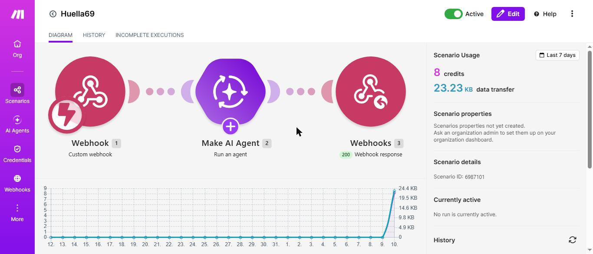
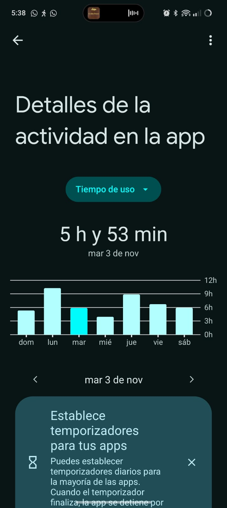
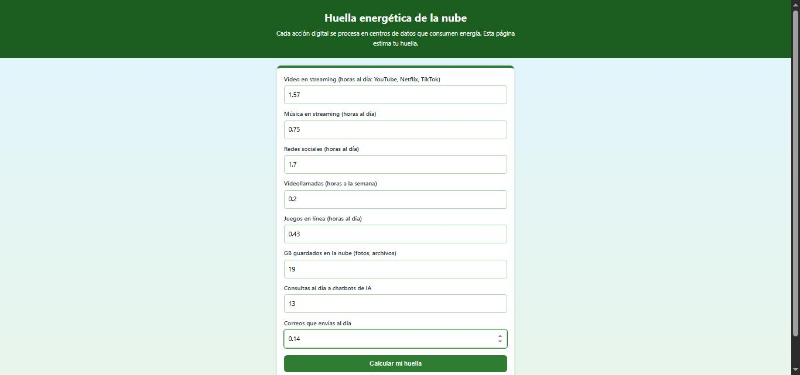
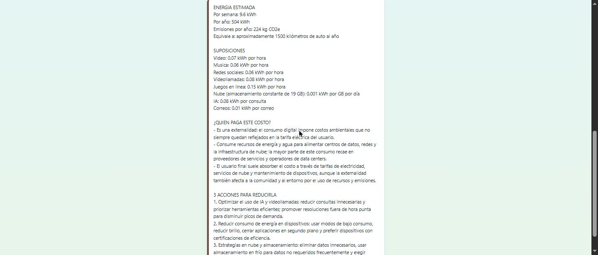

# Práctica 4.3 – Huella energética de la nube

| Dato | Valor |
|---|---|
| Estudiante | Roberto Carlos Robles Campos |
| Escuela | Tecnológico Nacional de México – Instituto Tecnológico de Mazatlán |
| Materia | Desarrollo Sustentable (ACD-0908) |
| Práctica | 4.3-P5 Huella energética de la nube |

**Página publicada:** https://roblescamposcarlos-beep.github.io/Huella_Energetica_Nube/
**Código:** [`codigo/index.html`](codigo/index.html) (la misma página; una copia está en la raíz para que GitHub Pages la publique) · **Escenario de Make:** [`codigo/blueprint.json`](codigo/blueprint.json) · **Resultados (PDF):** [`resultados/Resultados.pdf`](resultados/Resultados.pdf)

## 1. Objetivo
Reconocer el consumo de energía de los servicios digitales como un costo externalizado, estimar mi propia huella digital con apoyo de una IA y evaluar de forma crítica las suposiciones de esa estimación.

## 2. Investigación previa

**Externalidad negativa e internalización de costos.** Según Thomas Helbling (FMI, *Finanzas y Desarrollo*, 2017), las externalidades son efectos indirectos de las decisiones de consumo, producción o inversión sobre personas que no participan en la transacción, y no se reflejan en el precio del producto [1]. En una externalidad negativa, como la contaminación, quien contamina decide con sus costos directos y no considera los costos indirectos que sufren otros (peor calidad de vida, gastos de salud, producción perdida); el costo social supera al privado y se produce de más [1]. *Ejemplo:* una fábrica que contamina el aire de un barrio y no paga por el daño a la salud de los vecinos. La **internalización** consiste en lograr que quien genera el costo lo pague. El instrumento clásico es el impuesto pigouviano, que grava al contaminador por un monto equivalente al daño causado [1]. *Ejemplo en México:* la Ley del IEPS grava los combustibles fósiles según su contenido de carbono (por ejemplo, 17.7591 centavos por litro de gasolina y 21.5491 centavos por litro de diésel, con cuotas que se actualizan cada año), y permite pagar el impuesto con bonos de carbono [2].

**Energía de una hora de video en streaming (dos estimaciones distintas).**
- **IEA y Carbon Brief (2019–2020):** alrededor de **0.077 kWh por hora**, contando centros de datos, redes y dispositivos (televisión 70 %, portátil 15 %, tableta 10 %, smartphone 5 %) y un video de 4.1 Mbps en promedio [3][4].
- **The Shift Project:** su primera estimación fue de **6.1 kWh por hora**, y tras corregir un error quedó en **0.78 kWh por hora** [3][4].

Las dos difieren por los supuestos. La IEA y Carbon Brief señalan que el Shift Project supuso un video de 24 Mbps (unas 6 veces la media de Netflix), sobreestimó el consumo de los centros de datos unas 35 veces y el de las redes unas 50 veces, y subestimó el de los dispositivos unas 4 veces [3][4]. *Aclaración:* el texto de la IEA es una versión del análisis publicado en Carbon Brief, así que ambos cuentan como una sola estimación; la segunda es la del Shift Project corregida.

**Factor de emisión del Sistema Eléctrico Nacional.** El *Aviso del Factor de Emisión del Sistema Eléctrico Nacional 2024* de la SEMARNAT (28 de febrero de 2025) dice que la Comisión Reguladora de Energía notificó que el factor para el año 2024 es **0.444 tCO₂e/MWh**, es decir, **0.444 kg de CO₂e por kWh** [5]. Es el valor que uso en las instrucciones de la IA. No verifiqué si ya existe un aviso posterior (2025).

## 3. Cómo funciona

Flujo: **Página web → Webhook de Make → Make AI Agent → Webhook Response → Página web**.



| # | Módulo | Configuración |
|---|---|---|
| 1 | Webhooks → Custom webhook | Recibe `video`, `musica`, `redes`, `videollamadas`, `juegos`, `nube`, `ia` y `correos` |
| 2 | Make AI Agent | Conexión *Make's AI Provider*. Input: una línea por campo (por ejemplo `Video: {{1.video}} h/dia`). Instrucciones: analista de sustentabilidad digital; factor de emisión **0.444 kg CO₂e/kWh** (Aviso SEN 2024, SEMARNAT/CRE); indicar el kWh por hora o por unidad que supone en cada actividad; no presentar los resultados como datos exactos; formato fijo (energía estimada, suposiciones, ¿quién paga este costo?, 3 acciones) |
| 3 | Webhooks → Webhook response | Status 200, body = respuesta del agente; headers `Content-Type: text/plain; charset=utf-8` y `Access-Control-Allow-Origin: *` |

Se ejecuta **Immediately**. **La página** (`index.html`) tiene 8 campos numéricos con mínimo 0, valida que ninguno quede vacío, envía los datos con `fetch` y `URLSearchParams`, muestra "Calculando..." mientras espera y respeta los saltos de línea de la respuesta.

**Costo de una consulta:** 4.16 créditos de Make, 3 operaciones y unos 27 segundos. Una prueba anterior con datos de ejemplo gastó 4.05 créditos.

## 4. Mi uso digital (Actividad 2)

Lo saqué de **Bienestar digital** de mi celular OPPO Reno10 5G, con los promedios de **4 de los 7 días** de la semana del 1 al 7 de noviembre (lunes 2, miércoles 4, jueves 5 y viernes 6; si una app no aparece un día, cuenta 0).



| Campo | Valor | Cómo lo obtuve |
|---|---|---|
| Video | 1.57 h/día | Crunchyroll (52.5 min) + TikTok (11.5 min) medidos; **PureTuber, 30 min/día, es estimado** (en las capturas solo aparece el lunes, con 1 h 1 min) |
| Música | 0.75 h/día | Spotify, medido (87 y 93 min en 2 de los 4 días) |
| Redes sociales | 1.70 h/día | Facebook + Instagram, medido |
| Videollamadas | 0.2 h/semana | **Estimado:** no hago videollamadas regulares; las llamadas que hago duran máximo 10 minutos |
| Juegos en línea | 0.43 h/día | Mobile Legends, medido |
| Nube | 19 GB | **Estimado:** 3 cuentas, una con 10 GB y las otras con unos 6 y 3 GB |
| Consultas a IA | 13 al día | Medido solo en mi computadora (promedio de mensajes a Claude Code en 14 días: 185 mensajes). **No incluye** la app de Claude del celular ni otros chatbots; es un **mínimo** |
| Correos | 0.14 al día | Real: 1 correo enviado por semana |

**No cuenta en ninguna categoría:** WhatsApp (mensajes) y Chrome (navegación), ni Manga Dogs (lectura de manga en línea). Bienestar digital mide el tiempo con la pantalla encendida, así que la música que se escucha con la pantalla apagada no aparece.



## 5. Resultado de la IA




```
ENERGIA ESTIMADA
Por semana: 9.6 kWh
Por año: 504 kWh
Emisiones por año: 224 kg CO2e
Equivale a: aproximadamente 1500 kilómetros de auto al año

SUPOSICIONES
Video: 0.07 kWh por hora
Musica: 0.06 kWh por hora
Redes sociales: 0.06 kWh por hora
Videollamadas: 0.08 kWh por hora
Juegos en linea: 0.15 kWh por hora
Nube (almacenamiento constante de 19 GB): 0.001 kWh por GB por día
IA: 0.08 kWh por consulta
Correos: 0.01 kWh por correo

¿QUIEN PAGA ESTE COSTO?
- Es una externalidad: el consumo digital impone costos ambientales que no siempre quedan reflejados en la tarifa eléctrica del usuario.
- Consume recursos de energía y agua para alimentar centros de datos, redes y la infraestructura de nube; la mayor parte de este consumo recae en proveedores de servicios y operadores de data centers.
- El usuario final suele absorber el costo a través de tarifas de electricidad, servicios de nube y mantenimiento de dispositivos, aunque la externalidad también afecta a la comunidad y al entorno por el uso de recursos y emisiones.

3 ACCIONES PARA REDUCIRLA
1. Optimizar el uso de IA y videollamadas: reducir consultas innecesarias y priorizar herramientas eficientes; promover resoluciones fuera de hora punta para disminuir picos de demanda.
2. Reducir consumo de energía en dispositivos: usar modos de bajo consumo, reducir brillo, cerrar aplicaciones en segundo plano y preferir dispositivos con certificaciones de eficiencia.
3. Estrategias en nube y almacenamiento: eliminar datos innecesarios, usar almacenamiento en frío para datos no requeridos frecuentemente y elegir proveedores con energía renovable o certificaciones de eficiencia.
```

## 6. Comparación en el equipo (Actividad 6, Paso 8)

La práctica la hice de forma individual, así que la tabla tiene una sola fila.

| Integrante | kWh por año | kg CO₂e por año | Actividad que más consume |
|---|---|---|---|
| Roberto Robles | **504** según la IA (≈ **127** con la corrección de la sección 7) | **224** según la IA (≈ **56** con la corrección) | Según la IA, las consultas a IA (75 % del total); con la corrección, el video (32 %) y las redes (29 %) |

## 7. Verificación de las suposiciones de la IA

### 7.1 ¿Sumó bien? (suposiciones de la IA × mis datos)
Rehíce la cuenta con los propios valores de la IA, en kWh por día: video 1.57 × 0.07 = 0.110; música 0.75 × 0.06 = 0.045; redes 1.7 × 0.06 = 0.102; videollamadas 0.2 × 0.08 ÷ 7 = 0.002; juegos 0.43 × 0.15 = 0.065; nube 19 × 0.001 = 0.019; IA 13 × 0.08 = **1.040**; correos 0.14 × 0.01 = 0.001. Total: 1.384 kWh/día = **9.69 kWh por semana** y **504 kWh por año** (× 52 semanas). Las emisiones: 504 × 0.444 = **224 kg CO₂e**. Los 1500 km equivalen a unos 150 g de CO₂ por kilómetro, un valor razonable para un auto, aunque la IA no lo dice. **La aritmética de la IA está bien** (solo redondeó la semana a 9.6 en lugar de 9.7). En una prueba anterior, con otros datos, sí se había equivocado: dio 269.80 kWh por año cuando 5.38 × 52 son unos 280.

### 7.2 Paso 9: kWh por hora de video
La IA usó **0.07 kWh por hora de video**. Las dos estimaciones de la Actividad 1 son **0.077** (IEA y Carbon Brief) y **0.78** (Shift Project corregido). La suposición de la IA queda **un poco por debajo de la más baja** (9 % menos que 0.077) y **11 veces por debajo** de la del Shift Project. Es decir, **no está estrictamente dentro del rango, pero coincide prácticamente con la IEA**, que es la más aceptada porque corrige los errores del Shift Project.

### 7.3 La suposición que más pesa: 0.08 kWh por consulta de IA
Según la IA, mis consultas a chatbots son el 75 % de mi consumo (1.04 de 1.38 kWh al día). Esa cifra depende de que **una sola consulta gaste 0.08 kWh (80 Wh)**, y es muy alta:
- Google midió que una consulta de texto típica a Gemini consume **0.24 Wh** (0.00024 kWh) y 0.26 mL de agua [6].
- Epoch AI estima que una consulta típica a ChatGPT (GPT-4o) consume unos **0.3 Wh** (0.0003 kWh) [7].

La suposición de la IA es **entre 270 y 330 veces mayor** que esas dos mediciones. Cambiando solo ese valor, mi resultado queda así:

| Energía por consulta | kWh por semana | kWh por año | kg CO₂e por año | Peso de la IA en el total |
|---|---|---|---|---|
| 0.08 kWh (la IA) | 9.7 | 504 | 224 | 75 % |
| 0.003 kWh (10 veces lo medido, caso hipotético) | 2.7 | ≈ 139 | ≈ 62 | 10 % |
| 0.0003 kWh (Epoch AI) | 2.4 | 127 | 56 | 1 % |

Un detalle: mis consultas son sobre todo con Claude Code, que trabaja con textos largos y herramientas, así que cada mensaje puede gastar bastante más que una consulta típica; por eso 0.0003 es un valor mínimo y la realidad está entre las filas 2 y 3. Aun así, **mi huella digital real es varias veces menor que la que calculó la IA** (entre 127 y 139 kWh por año contra 504).

### 7.4 Suposiciones que no verifiqué
Música (0.06), redes (0.06), juegos (0.15), videollamadas (0.08), nube (0.001 kWh por GB por día) y correos (0.01 kWh) no las contrasté con fuentes. Con el valor corregido de la IA, mi consumo diario queda: video 32 %, redes 29 %, juegos 19 %, música 13 %, nube 5 %, IA 1 %, videollamadas y correos menos de 1 % cada una.

## Video de la prueba en vivo
*(pendiente)*

## 8. Preguntas de reflexión

**1. ¿Por qué el consumo de energía de la nube es una externalidad? ¿Quién la paga realmente?**
Porque el costo ambiental de procesar un video, una foto o una consulta de IA no está incluido en lo que pago. Según el FMI, una externalidad es un efecto indirecto sobre quienes no participan en la transacción y que no se refleja en el precio [1]. Yo pago mi plan de datos y la luz de mi celular, pero la electricidad de los centros de datos y de las redes, y el agua que usan para enfriarse, no aparecen en mi recibo. Google midió, por ejemplo, que una consulta de texto típica a Gemini consume 0.24 Wh de energía y 0.26 mL de agua [6]; es poco por consulta, pero se multiplica por millones de usuarios. Esa electricidad sale de una red que en México emite 0.444 kg de CO₂e por cada kWh [5], y las emisiones afectan al clima de toda la sociedad. Por eso quien la paga realmente es la sociedad y el ambiente, y en parte las empresas que operan los centros de datos y los usuarios con tarifas de electricidad más altas.

**2. ¿Qué actividad digital genera más consumo en su equipo y por qué?**
Según la IA, mis consultas a chatbots (75 % del total), pero ese resultado viene de una suposición equivocada de 0.08 kWh por consulta, unas 300 veces mayor que lo que midieron Google y Epoch AI [6][7]. Con una cifra corregida de 0.0003 kWh, la actividad que más consume es el **video**, con 32 % (1.57 horas al día en Crunchyroll, TikTok y PureTuber), seguida de las **redes sociales**, con 29 % (1.7 horas al día en Facebook e Instagram). Entre las dos suman 61 %. La razón es el tiempo: aunque cada hora de video o de redes gasta poco, las uso varias horas al día. Hay que recordar que estas cifras por hora (0.07 y 0.06 kWh) son las que supuso la IA y solo la de video la pude contrastar con fuentes.

**3. ¿Qué tan confiable es la estimación de la IA? ¿Qué suposición cambiaría más el resultado?**
Es confiable en la aritmética y poco confiable en las suposiciones. La IA sumó bien: 9.7 kWh por semana, 504 por año y 224 kg de CO₂e con el factor 0.444. Pero entregó números exactos sin rangos, a pesar de que las instrucciones le pedían no presentarlos como datos exactos. La suposición que más cambia el resultado es la energía por consulta de IA: pasar de 0.08 a 0.0003 kWh baja mi resultado de 504 a 127 kWh por año (75 % menos) y de 224 a 56 kg de CO₂e. La de video (0.07 kWh por hora) coincide con la de la IEA, y no cambiaría mucho el total. Además, mis propios datos tienen incertidumbre: son promedios de 4 días, y la nube, las videollamadas y PureTuber son estimados.

**4. ¿Cómo podría internalizarse este costo (impuestos, energía renovable en centros de datos, precios distintos)?**
Con impuestos pigouvianos, que cobran a quien contamina por el daño que causa [1]: en México ya existe uno para los combustibles fósiles, que paga el contenido de carbono (por ejemplo, 17.7591 centavos por litro de gasolina) y permite pagar con bonos de carbono [2]; algo parecido podría aplicarse a la electricidad generada con combustibles fósiles que consumen los centros de datos. También con la obligación de que los centros de datos usen energía renovable y publiquen su consumo, como hizo Google al publicar su medición [6]. Y con precios que reflejen el consumo: por ejemplo, planes de video que cobren distinto según la calidad (el video en alta resolución gasta más), o avisos en la app de cuánta energía gasta una acción. El factor de emisión de la red (0.444 kg por kWh) baja si aumenta la energía limpia, así que cada kWh renovable también internaliza parte del costo.

**5. ¿Qué cambio en su uso digital están dispuestos a hacer?**
*(Borrador, para que lo revise y lo cambie el estudiante.)* Mi mayor consumo está en el video y las redes, así que empezaría por bajar la calidad del video cuando no la necesito (por ejemplo, 480p en el celular), preferir Wi-Fi a los datos móviles y quitar la reproducción automática de TikTok y Facebook. También limpiaría la nube: borrar fotos y archivos duplicados de mis 3 cuentas, que suman unos 19 GB. Para la IA, agruparía varias preguntas en una sola consulta y revisaría mis conversaciones largas antes de empezar otra. Para saber si funciona, repetiría esta práctica en un mes con las mismas apps y compararía mi tiempo de video y de redes en Bienestar digital.

## 9. Fuentes

Leídas el 10 de noviembre de 2026.

1. Thomas Helbling, *Externalities: Prices Do Not Capture All Costs*, Finanzas y Desarrollo (FMI), 10/05/2017: <https://www.imf.org/en/publications/fandd/issues/series/back-to-basics/externalities>
2. Ley del Impuesto Especial sobre Producción y Servicios, texto vigente (última reforma DOF 07-11-2025; cuotas actualizadas por Acuerdo DOF 22-12-2025), art. 2, fracción I, inciso H: <https://www.diputados.gob.mx/LeyesBiblio/pdf/LIEPS.pdf>
3. Carbon Brief, *Factcheck: What is the carbon footprint of streaming video on Netflix?*, 25/02/2020 (actualizado 25/11/2020): <https://carbonbrief.org/factcheck-what-is-the-carbon-footprint-of-streaming-video-on-netflix/>
4. IEA, *The carbon footprint of streaming video: fact-checking the headlines*, diciembre de 2020: <https://www.iea.org/commentaries/the-carbon-footprint-of-streaming-video-fact-checking-the-headlines>
5. SEMARNAT, *Aviso: Factor de emisión del Sistema Eléctrico Nacional 2024* (28/02/2025): <https://www.gob.mx/cms/uploads/attachment/file/981194/aviso_fesen_2024.pdf> (versión de la CRE con el mismo valor: <https://www.gob.mx/cms/uploads/attachment/file/980977/AvisoFESEN_2024.pdf>)
6. Google, *Measuring the environmental impact of delivering AI at Google Scale* (arXiv 2508.15734, 21/08/2025): <https://arxiv.org/abs/2508.15734>
7. Epoch AI, *How much energy does ChatGPT use?*, febrero de 2025: <https://epoch.ai/blog/how-much-energy-does-chatgpt-use>
